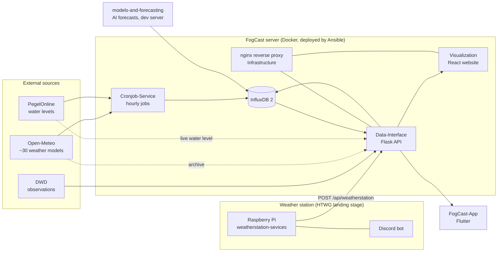

# FogCast

FogCast analyses, evaluates and presents weather data for the Lake Constance region. It collects forecasts from many weather models, measures the real weather with its own station at the HTWG landing stage, compares models against each other, and shows everything on a website and in an app.

> Project of the Master of Computer Science program at HTWG Konstanz.
> **This repository is the entry point:** it explains how all parts fit together and contains the deployment (Ansible). The actual code lives in the repositories listed below.

| | |
|---|---|
| Website | https://fogcast.in.htwg-konstanz.de |
| API | https://fogcast.in.htwg-konstanz.de/api/ |
| GitHub organisation | https://github.com/FogCast-Konstanz |

---

## Contents
1. [How FogCast works](#1-how-fogcast-works)
2. [Repository map](#2-repository-map)
3. [Where to start (by role)](#3-where-to-start-by-role)
4. [Local development](#4-local-development)
5. [Deployment](#5-deployment)
6. [Operations: health checks, logs, troubleshooting](#6-operations-health-checks-logs-troubleshooting)
7. [Data model](#7-data-model)
8. [Configuration and secrets](#8-configuration-and-secrets)
9. [Contributing](#9-contributing)
10. [Glossary](#10-glossary)

---

## 1. How FogCast works



**In words:**
1. The **Cronjob-Service** fetches the forecasts of many weather models (Open-Meteo) every hour and regularly the water levels (PegelOnline), stores them in **InfluxDB** and computes a model benchmark.
2. The **weather station** (Raspberry Pi with an air and a water sensor) sends measured values every ~23 s to the **Data-Interface** API, which stores them in InfluxDB.
3. **models-and-forecasting** trains AI correction models and writes its own forecasts (`ki_*`) into InfluxDB.
4. The **Data-Interface** API serves all data. Live and historical observations (DWD, PegelOnline, Open-Meteo archive) are fetched by the API itself on request. The **website** (Visualization) and the **app** (FogCast-App) read through this API; the website additionally shows the cron status from `/cronjob/status`.
5. **nginx** (Infrastructure) terminates TLS and routes `/` to the website, `/api/` to the API and `/cronjob/` to the cron status page.

## 2. Repository map

| Repository | What it is | Tech | Runs where | Deployed by |
|---|---|---|---|---|
| [**FogCast**](https://github.com/FogCast-Konstanz/FogCast) | this entry point + Ansible deployment | Ansible | your machine | – |
| [**Infrastructure**](https://github.com/FogCast-Konstanz/Infrastructure) | nginx reverse proxy (TLS, routing), InfluxDB | Docker Compose | FogCast server | Ansible |
| [**Data-Interface**](https://github.com/FogCast-Konstanz/Data-Interface) | REST API: forecasts, models, benchmarks, station data, live data | Python, Flask, Gunicorn | FogCast server (`fogcast-api`) | Ansible |
| [**Cronjob-Service**](https://github.com/FogCast-Konstanz/Cronjob-Service) | hourly data collection (Open-Meteo, PegelOnline), model benchmarking, status page | Python, cron | FogCast server (`fogcast-cron-runner`, `fogcast-status-reporter`) | Ansible |
| [**Visualization**](https://github.com/FogCast-Konstanz/Visualization) | the website | React, TypeScript, Vite, Chakra UI, Plotly | FogCast server (`fogcast-frontend`) | Ansible |
| [**FogCast-App**](https://github.com/FogCast-Konstanz/FogCast-App) | mobile app | Flutter, Riverpod | phones | manual |
| [**weatherstation-sevices**](https://github.com/FogCast-Konstanz/weatherstation-sevices) | software of the weather station: measuring, local buffer, upload, Discord bot | Python, systemd | Raspberry Pi at the landing stage | manual (see its README) |
| [**weather-station-pico**](https://github.com/FogCast-Konstanz/weather-station-pico) | second station with more sensors (UV, pressure, IMU), **not connected yet** | MicroPython, Raspberry Pi Pico 2 | – | – |
| [**models-and-forecasting**](https://github.com/FogCast-Konstanz/models-and-forecasting) | model benchmarking analyses, AI forecasting pipeline (RF, LSTM, CNN) | Python, scikit-learn, TensorFlow | dev server (cron) | manual |
| [**presentations**](https://github.com/FogCast-Konstanz/presentations) | slides and talks of the project | LaTeX, PowerPoint | – | – |

> The repository name `weatherstation-sevices` contains a typo, but it is the real name; do not "fix" it in links.

## 3. Where to start (by role)

| You want to … | Read first | Then |
|---|---|---|
| **understand the project** | this README, section 1 | [presentations](https://github.com/FogCast-Konstanz/presentations) |
| **work on the website** | Visualization README | Data-Interface README (API endpoints) |
| **work on the API** | Data-Interface README | section 7 (data model), Infrastructure README |
| **add or change data sources** | Cronjob-Service README | section 7 (data model) |
| **maintain the weather station** | weatherstation-sevices README | section 6 (health checks) |
| **work on forecasts / AI models** | models-and-forecasting README (`forecasting/`) | section 7 |
| **deploy or run the server** | section 5 and Infrastructure README | section 6 and 8 |

**New maintainer checklist:**
- [ ] Access to the GitHub organisation `FogCast-Konstanz`
- [ ] SSH access to the FogCast server (and the dev server, if you work on forecasting) — ask a current maintainer
- [ ] SSH access to the weather station Pi — ask a current maintainer
- [ ] Access to the Discord channel of the weather station bot
- [ ] Read sections 5–8 of this README once completely

## 4. Local development

**Prerequisites:** Git, Docker + Docker Compose, Python 3.10+, Node.js 22 (website), Ansible (only for deployment).

Clone all repositories next to each other:

```bash
mkdir fogcast && cd fogcast
for r in FogCast Infrastructure Data-Interface Cronjob-Service Visualization FogCast-App \
         weatherstation-sevices weather-station-pico models-and-forecasting presentations; do
  git clone https://github.com/FogCast-Konstanz/$r.git
done
```

All server containers share one Docker network, which has to exist once:

```bash
docker network create proxy-net
```

Then follow the README of the repository you work on. Each service runs with `docker compose up` in its own directory; secrets are needed first (section 8). Infrastructure additionally expects the TLS certificate under `/etc/ssl/`, so for local work you usually start only the service you are working on.

## 5. Deployment

The **server part** (Infrastructure, Data-Interface, Cronjob-Service, Visualization) is deployed with Ansible from this repository. The playbook clones/updates the four repositories into `~/FogCast/` on the server, builds and starts their containers, restarts the reverse proxy and removes unused images.

1. Copy the inventory example and fill in the server:
   ```bash
   cp ansible/inventories/prod/hosts.example.ini ansible/inventories/prod/hosts.ini
   ```
2. Choose the branch per repository in `ansible/inventories/<env>/group_vars/all.yml` (default: `main`).
3. Deploy:
   ```bash
   ansible-playbook -i ansible/inventories/dev/hosts.ini  ansible/playbook.yml   # development
   ansible-playbook -i ansible/inventories/prod/hosts.ini ansible/playbook.yml   # production
   ```

**Not covered by Ansible** (must exist on the server beforehand):
- the Docker network `proxy-net` (see section 4)
- secrets and TLS certificates (section 8)

**Deployed separately:**
- weather station → see the weatherstation-sevices README
- AI forecasting → see the models-and-forecasting README
- app → see the FogCast-App README

> The playbook updates the repositories with `force: yes`: local changes on the server are overwritten on every deployment.

## 6. Operations: health checks, logs, troubleshooting

| Check | How | Expected |
|---|---|---|
| Website / proxy | `https://fogcast.in.htwg-konstanz.de/health-check` | `success` |
| API | `https://fogcast.in.htwg-konstanz.de/api/health-check` | `success` |
| Cron jobs | `https://fogcast.in.htwg-konstanz.de/cronjob/status` | `{"status": "success"}` |
| Newest station data | `GET /api/weatherstation?start=…&stop=…` (UTC, `YYYY-MM-DDTHH:MM:SSZ`) | values from the last minutes |
| Weather station (Pi) | `systemctl status weatherservice` · `journalctl -u weatherservice -f` | `active`, a `Mean data …` line every ~23 s |
| Weather station (Discord) | `!weatherstatus`, `!getdata` in the station channel | `running`, current values |

> Known limitations: `/cronjob/status` only scans the cron log for errors and may report `success` although a job did not write data. `GET /api/weatherstation` currently answers HTTP 500 instead of an empty list if the time range contains no data.

**Logs on the server:** `docker logs <container>` (`fogcast-reverse-proxy`, `fogcast-api`, `fogcast-cron-runner`, `fogcast-status-reporter`, `fogcast-frontend`, `fogcast-influxdb`).

**Typical problems:**
- *Website shows old station values* → check the station (table above). If the server was unreachable, the station buffers its measurements locally and sends them later, the newest first.
- *No new forecasts* → `/cronjob/status` and `docker logs fogcast-cron-runner`.
- *Everything down after a deployment* → does `proxy-net` exist, and are the secrets in place (section 8)?

## 7. Data model

All data is stored in **InfluxDB 2**, organisation `FogCast`.

| Bucket | Content | Written by | Read by |
|---|---|---|---|
| `WeatherForecast` | measurement `forecast` (all weather models + AI forecasts `ki_*`, tags `model`, `forecast_date`), measurement `water_level` | Cronjob-Service, models-and-forecasting | Data-Interface, benchmarking |
| `WeatherData` | measurement `weather_station`: `temperature`, `humidity`, `water_temperature` | Data-Interface (from the station) | Data-Interface, models-and-forecasting |
| `benchmark_score` | measurement `forecast_error`: error per model and field | Cronjob-Service | Data-Interface |

Times are always **UTC**.

## 8. Configuration and secrets

Secrets are **never** committed. Each part reads them from its own place:

| Part | Secrets / config | Where |
|---|---|---|
| Infrastructure | InfluxDB admin user/password, TLS certificate | `.env.influxdb2-admin-*` files, `/etc/ssl/` on the server |
| Data-Interface | `INFLUXDB_URL`, `INFLUXDB_TOKEN`, `API_KEY` (token of the station) | `.env` in the repository directory on the server |
| Cronjob-Service | InfluxDB token, Discord webhook | `cron-runner/settings.user.json` |
| Weather station | upload token | `.weather_token` on the Pi |
| models-and-forecasting | InfluxDB access | `settings*.user.json` / environment variables on the dev server |

When a token changes, update **every** place that uses it before revoking the old one.

## 9. Contributing

- Work on a feature branch, open a pull request into `main`, and let someone else review it.
- Keep the README of the repository up to date in the same pull request.
- Run the tests of the repository before opening the pull request (where available).
- Never commit secrets, tokens or `*.user.json` / `.env` files.


## 10. Glossary

| Term | Meaning |
|---|---|
| **Weather model** | a numerical weather forecast of a weather service (e.g. ICON by DWD, IFS by ECMWF); FogCast compares ~30 of them |
| **Open-Meteo** | free API that delivers the forecasts of many weather models |
| **Benchmark** | comparison of how well each weather model predicted the actual weather |
| **AI correction (`ki_*`)** | FogCast's own forecasts: a weather model corrected by trained models (Random Forest, LSTM, CNN) |
| **Weather station** | FogCast's own sensors at the HTWG landing stage (air and water temperature, humidity) |
| **PegelOnline** | official German water level service (Lake Constance, Rhine) |
| **InfluxDB** | time series database that stores all FogCast data |
